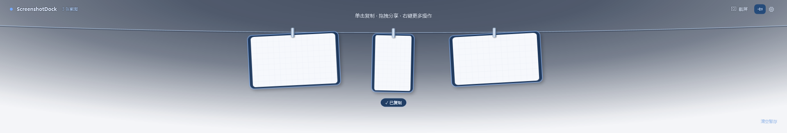
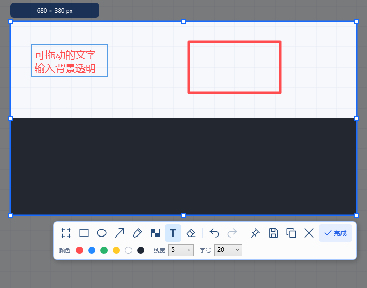

<p align="center">
  
</p>

<h1 align="center">ScreenshotDock</h1>

<p align="center">截图即收纳，随取随用。</p>

<p align="center">
  Windows 桌面工具 · C# / .NET 10 / WPF · <a href="LICENSE">MIT License</a>
</p>

ScreenshotDock 将截图、标注、桌面贴图和临时图片收纳放在一起。按 **F1** 开始截图，编辑后自动放入屏幕顶部的晾衣绳暂存栏；按 **F3** 将当前截图或最近一张图片贴到屏幕，方便对照、记录和分享。



## 功能

- **截图与自动选区**：悬停识别窗口和控件，单击确认，也可以自由拖动框选。
- **标注编辑**：矩形、圆形、画笔、五种箭头样式、框选马赛克、中文及多行文字，支持撤销和重做。形状与马赛克可移动、缩放；文字输入背景透明，可拖动边框移动并再次编辑。
- **多张桌面贴图**：置顶显示多张图片，拖动内部移动，拖动边缘等比例缩放；选中贴图显示蓝色阴影，按 Esc 移除当前贴图。
- **顶部暂存栏**：从屏幕顶部中间触发，展开后覆盖主屏宽度。挂绳与卡片带展开、收回动画，移出热区自动隐藏；滚轮浏览、单击复制、拖拽分享。
- **本地管理**：PNG 保存、截图去重、数量与保留期限设置、重启恢复、清空二次确认、全屏避让、系统托盘和开机启动。
- **自定义快捷键**：截图和贴图分别设置，支持单键与组合键。



## 下载与运行

最新版本：**v1.0.0**，适用于 **Windows 10 / 11 x64**。

- [直接下载 EXE](https://github.com/luorenshu/ScreenshotDock/releases/download/v1.0.0/ScreenshotDock.exe)：下载后运行 `ScreenshotDock.exe`，无需安装或预装 .NET。
- [下载完整 ZIP 包（推荐）](https://github.com/luorenshu/ScreenshotDock/releases/download/v1.0.0/ScreenshotDock-1.0.0-win-x64.zip)：包含 EXE、使用说明和许可证，解压后运行。
- [查看更新与所有版本](https://github.com/luorenshu/ScreenshotDock/releases)：发行说明和下载文件均在 GitHub Releases 提供。

单独下载 EXE 时，可一并获取 [许可证文件包](https://github.com/luorenshu/ScreenshotDock/releases/download/v1.0.0/ScreenshotDock-1.0.0-licenses.zip)。文件校验值见发行页的 `SHA256SUMS.txt`。

## 快速使用

1. 启动后按 **F1**，单击自动识别的区域或拖动框选。
2. 使用选区右下方的工具栏标注，选择完成、复制、保存或贴图。
3. 将鼠标移到主屏顶部中间，展开暂存栏；单击图片复制，拖出图片分享。
4. 按 **F3** 将当前选区或最近截图贴到桌面。在设置中可修改快捷键和保留策略。

| 快捷键 | 操作 |
| --- | --- |
| F1 | 开始截图，默认全局快捷键 |
| F3 | 贴图，默认全局快捷键 |
| Esc / 鼠标右键 | 取消截图；编辑或拖动中 Esc 优先取消当前操作 |
| Enter / Shift + Enter | 确认文字 / 文字换行 |
| Ctrl + Z / Ctrl + Y | 撤销 / 重做；文字输入时使用文本框的编辑历史 |
| Ctrl + S | 保存当前截图 |
| Ctrl + C | 复制当前截图；文字输入时复制选中的文字 |

完整操作见 [使用说明](docs/使用说明.md)。

## 从源码运行

目标平台为 **Windows 10 / 11 x64**。开发与构建使用 Git 和 PowerShell。

```powershell
git clone https://github.com/luorenshu/ScreenshotDock.git
cd ScreenshotDock
powershell -ExecutionPolicy Bypass -File .\scripts\run.ps1
```

SDK 版本由 [global.json](global.json) 指定。脚本优先使用项目内的 `.tools/dotnet`，其次使用系统安装的 .NET 10 SDK；没有可用的 .NET 10 SDK 时，下载官方 10.0.401 SDK 到项目的 `.tools`，不修改系统 PATH。使用系统 SDK 时，其版本需满足 `global.json`。

首次获取 SDK、还原依赖和自包含发布需要网络。应用正常运行使用本地存储。

## 构建与发布

```powershell
# 构建解决方案
powershell -ExecutionPolicy Bypass -File .\scripts\build.ps1

# 生成 Windows x64 自包含程序和 ZIP
powershell -ExecutionPolicy Bypass -File .\scripts\publish.ps1
```

发布输出：

```text
artifacts/
├── ScreenshotDock-win-x64/
│   ├── ScreenshotDock.exe
│   ├── LICENSE
│   ├── THIRD_PARTY_NOTICES.md
│   ├── licenses/
│   └── 使用说明.md
└── ScreenshotDock-1.0.0-win-x64.zip
```

自包含程序无需预装 .NET，可将整个发布目录或解压后的 ZIP 交付给使用者。发布脚本附带项目许可证和所用运行时的第三方许可文件。重新发布前，请先从系统托盘退出正在运行的旧程序。

## 测试

```powershell
# 单元测试
powershell -ExecutionPolicy Bypass -File .\scripts\test.ps1

# 单元测试及截图标注、马赛克、文字编辑、保存和贴图流程
powershell -ExecutionPolicy Bypass -File .\scripts\test.ps1 -Annotations
```

可按需增加以下测试开关：

| 开关 | 验证范围 |
| --- | --- |
| `-Pin` | 多张贴图、选择、移动、边缘缩放和 Esc |
| `-Edge` | 顶部触发、自动隐藏和截图生命周期 |
| `-Settings` | 设置、开机启动和清空确认 |
| `-SmartSelection` | 窗口与控件自动选区 |
| `-Shortcuts` | 全局快捷键、冲突、互换和持久化 |
| `-Editor` | 编辑器及系统剪贴板流程 |
| `-Integration` | 完整桌面集成流程，包括剪贴板与文件拖放 |

桌面集成测试需要交互式 Windows 会话，会短暂显示专用测试窗口，并使用独立缓存。`-Editor` 和 `-Integration` 会访问系统剪贴板，请在测试前保存需要保留的剪贴板内容。结果和示例图输出到 `artifacts/`。

已执行验证与待补测项目见 [验收记录](docs/验收记录.md)。

## 项目结构

| 目录 | 内容 |
| --- | --- |
| `src/ScreenshotDock.Core` | 数据模型、标注历史、配置、截图存储和清理 |
| `src/ScreenshotDock.Windows` | Win32 截图、显示器、快捷键、剪贴板、托盘和开机启动 |
| `src/ScreenshotDock.App` | WPF 截图编辑器、顶部暂存栏、贴图、设置和应用生命周期 |
| `tests/` | 单元测试与 Windows 桌面集成测试 |
| `assets/` | Logo、应用图标和光标资源 |
| `scripts/` | SDK 获取、运行、构建、测试、发布和资源生成 |
| `docs/` | 使用说明、验证记录和界面示例 |

SDK 缓存、构建产物、测试输出和本机配置由 [.gitignore](.gitignore) 排除；用于编译的图标、光标和文档示例图随源码提交。

## 数据与适用范围

截图、缩略图、配置和日志默认存放在：

```text
%LOCALAPPDATA%\ScreenshotDock\
```

暂存库用于临时收纳，默认最多 100 张、保留 7 天，并按设置自动清理。需要长期保存的图片，请通过保存功能导出到其他目录。

当前实际验证环境为 Windows 10 x64。Windows 11、混合 DPI、多屏热插拔、中文输入法及不同应用的拖放行为仍需在对应设备验证。受保护的画面可能无法采集。当前版本未包含 OCR、长截图、历史搜索和云同步。

## 参与贡献

欢迎通过 [Issues](https://github.com/luorenshu/ScreenshotDock/issues) 反馈问题或提出功能建议，也欢迎提交 Pull Request。

反馈问题时请提供 Windows 版本、显示器分辨率与缩放、复现步骤；附图和日志请先移除私人信息。贡献代码前请完成构建与相关测试，涉及界面交互的改动请附上演示图或验证结果。

## 许可证

项目采用 [MIT License](LICENSE)。第三方组件保留各自许可证，详见 [第三方声明](THIRD_PARTY_NOTICES.md)。
